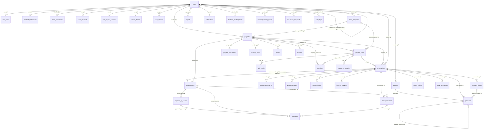

# SCHEMA.md — Database Schema

Reference only. Every table below was checked against the live MySQL/MariaDB schema, and
`tests/Feature/SchemaDocTest.php` fails when a column or table here disagrees with the database.
**Update this file in the same change as the migration.** The reasoning behind a design lives in
ARCHITECTURE.md §6 (Key Decisions Log); dated changes live in CHANGELOG.md.

How to read the tables: `NN` = NOT NULL, `null` = nullable, `= x` = default. Primary keys are custom
(`$primaryKey = 'user_id'` etc. on each model), not `id`. "FK → t, cascade" is the `onDelete` rule.
Row format is one column per row (the test parses the first cell).

## 1. ERD

Relationships only (columns are in §2). Every table with a `tenant_id`, `landlord_id` or `actor_id`
points at `users`; the less obvious ones are listed here.

## 2. Tables — Identity

### users
A person. Tenants, landlords and admins are all rows here; the role lives in `user_roles`.

| Column | Type | Null / default | Key | Note |
|---|---|---|---|---|
| user_id | bigint unsigned | NN | PK | |
| first_name | varchar(255) | NN | | |
| last_name | varchar(255) | NN | | |
| email | varchar(255) | null | UNIQUE | Null for walk-in tenants with only a phone; render with `?: '—'` |
| email_verified_at | timestamp | null | | Set immediately for social-login accounts |
| password | varchar(255) | NN | | Hashed |
| contact_number | varchar(20) | null | | |
| profile_picture | varchar(255) | null | | Cloudinary URL |
| bio | text | null | | |
| profile_visibility | enum('public','landlords_only','private') | NN, = 'private' | | |
| account_status | enum('active','suspended','inactive') | NN, = 'active' | index | |
| is_walk_in | boolean | NN, = 0 | | Landlord-entered tenant; drives the **Walk-in** pill everywhere |
| created_by_landlord_id | bigint unsigned | null | FK → users, set null | Scopes `User::walkInTenants()` |
| landlord_terms_accepted_at | timestamp | null | | When the landlord accepted the money-handling terms; asked once per payment route (`App\Support\LandlordTerms`) |
| landlord_terms_payment_mode | varchar(10) | null | | `online` or `direct`: the route the acceptance covered. A change of route asks again |
| remember_token | varchar(100) | null | | |
| created_at | timestamp | null | | |
| updated_at | timestamp | null | | |

Rules:
- Walk-in and social-login accounts get a random unknowable password. A walk-in is also `inactive`, so it can never log in or leave a review; keeping walk-ins in `users` is what lets `reservations.tenant_id` stay NOT NULL.
- Payout details live in `user_payout_accounts`, social logins in `social_accounts`, push tokens in `user_devices`. `User::hasPayoutDestination()` needs both GCash fields before an admin can record a payout.
- Deleting a user cascades almost every FK (RULES.md → Hard deletes). `Admin\UserController::destroy` blocks it once the user has records; suspend instead.

### social_accounts
A Google/Facebook login linked to a user. A user can link several; linking by email adds a row and never overwrites one.

| Column | Type | Null / default | Key | Note |
|---|---|---|---|---|
| social_account_id | bigint unsigned | NN | PK | |
| user_id | bigint unsigned | NN | FK → users, cascade | UNIQUE with `provider` |
| provider | varchar(30) | NN | UNIQUE with `provider_id` | `google` / `facebook` |
| provider_id | varchar(255) | NN | | The provider's own user id |
| created_at | timestamp | null | | |
| updated_at | timestamp | null | | |

### user_payout_accounts
A landlord's GCash payout destination. A row exists only while details are set (`User::savePayoutAccount()` deletes it when both are blank). Never part of a nested user payload.

| Column | Type | Null / default | Key | Note |
|---|---|---|---|---|
| user_id | bigint unsigned | NN | PK, FK → users, cascade | |
| gcash_number | varchar(255) | null | | |
| gcash_account_name | varchar(255) | null | | Name on the account, so an admin can verify before sending |
| created_at | timestamp | null | | |
| updated_at | timestamp | null | | |

### tenant_details
A tenant's emergency contact and the ID they showed, kept for the landlord. One row per user, created on first save (signing an agreement, Account Settings, the walk-in form, or a landlord filling in a walk-in). Never part of a nested user payload, a CSV export or `lease_snapshot`.

| Column | Type | Null / default | Key | Note |
|---|---|---|---|---|
| user_id | bigint unsigned | NN | PK, FK → users, cascade | |
| emergency_contact_name | varchar(150) | null | | |
| emergency_contact_relationship | varchar(50) | null | | One of `TenantDetail::RELATIONSHIPS` |
| emergency_contact_number | varchar(20) | null | | |
| id_type | varchar(50) | null | | One of `TenantDetail::ID_TYPES` |
| id_number | text | null | | `encrypted` cast, so the column holds ciphertext. Masked to the last 4 by `TenantDetail::maskedIdNumber()`; shown in full only to the tenant and, behind a Show button, the landlord on the tenancy page |
| created_at | timestamp | null | | |
| updated_at | timestamp | null | | |

Rules: `TenantDetail::isComplete()` needs name, number, ID type and ID number (the relationship is optional). Signing an agreement requires a complete row; `saveFor()` skips blank fields so an empty form never wipes saved values. Only the landlord of a property with a `Reserved`, `Occupied` or `Completed` reservation for this tenant may read it (`ReservationPolicy::viewTenantDetails`).

### user_devices
One row per phone registered for mobile push. A token that changes hands moves to the new user; a row is deleted when Expo reports `DeviceNotRegistered`.

| Column | Type | Null / default | Key | Note |
|---|---|---|---|---|
| device_id | bigint unsigned | NN | PK | |
| user_id | bigint unsigned | NN | FK → users, cascade | |
| expo_push_token | varchar(255) | NN | UNIQUE | |
| created_at | timestamp | null | | |
| updated_at | timestamp | null | | |

### user_roles
| Column | Type | Null / default | Key | Note |
|---|---|---|---|---|
| role_id | bigint unsigned | NN | PK | |
| user_id | bigint unsigned | NN | FK → users, cascade | UNIQUE with `role` |
| role | enum('Tenant','Landlord','Admin') | NN | index `(role, user_id)` | Landlord granted on verification approval |
| assigned_at | timestamp | NN, = now | | |

### landlord_verifications
One application per landlord. Government ID, selfie and ID back live on the **private** disk.

| Column | Type | Null / default | Key | Note |
|---|---|---|---|---|
| verification_id | bigint unsigned | NN | PK | |
| user_id | bigint unsigned | NN | FK → users, cascade, UNIQUE | |
| government_id | varchar(255) | NN | | Private-disk path |
| id_back | varchar(255) | null | | |
| id_type | varchar(255) | NN | | |
| selfie | varchar(255) | NN | | |
| liveness_passed | boolean | NN, = 0 | | False = manual-capture fallback; admin screen shows a warning |
| id_image_hash | varchar(64) | NN | | Duplicate-ID detection |
| id_number | varchar(255) | null | | |
| ocr_name | varchar(255) | null | | |
| ocr_confidence | tinyint unsigned | null | | |
| ocr_status | varchar(255) | null | | |
| business_name | varchar(255) | null | | Copied to `rental_businesses` on approval |
| description | text | null | | |
| logo_url | varchar(255) | null | | |
| contact_number | varchar(255) | null | | |
| business_address | varchar(255) | null | | |
| verification_status | enum('Pending','Approved','Rejected') | NN, = 'Pending' | | |
| admin_notes | text | null | | Rejection reason |
| reviewed_by | bigint unsigned | null | FK → users, set null | |
| reviewed_at | timestamp | null | | |
| submitted_at | timestamp | NN, = now | | |

### rental_businesses
A landlord's public profile. Created by `Admin\VerificationController::approve()` alongside the role grant.

| Column | Type | Null / default | Key | Note |
|---|---|---|---|---|
| business_id | bigint unsigned | NN | PK | |
| landlord_id | bigint unsigned | NN | FK → users, cascade, UNIQUE | One per landlord |
| business_name | varchar(255) | null | | |
| description | text | null | | |
| logo_url | varchar(255) | null | | Cloudinary `secure_url` |
| logo_public_id | varchar(255) | null | | Needed to `destroy()` the old logo |
| contact_number | varchar(255) | null | | |
| business_address | varchar(255) | null | | |
| created_at | timestamp | null | | |
| updated_at | timestamp | null | | |

Rules:
- Every "Verified Host" check reads `landlord.rentalBusiness` existence. An Approved landlord without a row is invisible to them (backfill `2026_08_21_000000`).
- There is no property ↔ business FK; the link is `landlord_id` on both.

## 2. Tables — Listings

### properties
A listing (building or house). Price, occupancy and availability live on its units.

| Column | Type | Null / default | Key | Note |
|---|---|---|---|---|
| property_id | bigint unsigned | NN | PK | |
| landlord_id | bigint unsigned | NN | FK → users, cascade | |
| title | varchar(255) | NN | | |
| description | text | NN | | |
| house_rules | json | null | | Flat list of strings: preset labels from `PropertyPolicies::HOUSE_RULES`, then custom lines. Cast to array; every unit inherits it |
| default_lease_terms | text | null | | Landlord's standard extra terms, private (never on the listing or in an API resource). Prefills "Additional terms" when an agreement is sent; the agreed text is frozen per reservation in `agreement_terms_notes`. Editing it does not send an approved listing back to review |
| lease_template_id | bigint unsigned | null | FK → lease_templates, set null | The lease this property sends (`App\Support\LeaseTemplates`). Null = the standard lease. A unit's own template wins |
| rent_grace_days | tinyint unsigned | null | | Days after the due date before rent counts as late. null = platform default (`rentals.rent_overdue_grace_days`). A default only: frozen into the lease snapshot as `grace_days` |
| late_fee_type | enum('percent','fixed') | null | | null = no late fee. Frozen into the lease snapshot as `late_fee` |
| late_fee_value | decimal(10,2) | null | | Percent of monthly rent (0.01 to 100) or a peso amount, per `late_fee_type` |
| property_type | enum('Apartment','Dormitory','House','Boarding House','Bedspace') | NN | index | A single room is a *unit*, not a type |
| living_arrangement | enum('Private','Shared','Mixed') | null | | Required by forms; null only on legacy rows |
| occupancy_preference | enum('No Preference','Men Only','Women Only') | NN, = 'No Preference' | | |
| water_included | boolean | null | | Null = landlord never answered; `false` = explicitly not included |
| electricity_included | boolean | null | | Same |
| internet_included | boolean | null | | Same |
| association_fees_included | boolean | null | | Same |
| utilities_separately_metered | boolean | null | | Same |
| address | varchar(255) | NN | | Text-searched by browse |
| city_municipality | varchar(100) | NN | index | Must be in `config('cebu.lgus')` |
| barangay | varchar(100) | null | | |
| latitude | decimal(10,7) | NN | index `(latitude, longitude)` | Bounded to Cebu by `App\Rules\WithinCebu`; a pin is required |
| longitude | decimal(10,7) | NN | | |
| verification_status | enum('Pending','Approved','Rejected') | NN, = 'Pending' | index with `publication_status` | Admin's verdict on legitimacy |
| rejection_reason | text | null | | Shown to the landlord on reject |
| publication_status | enum('Draft','Published','Unpublished','Suspended') | NN, = 'Published' | | "Should it be live right now" |
| created_at | timestamp | null | index | |
| updated_at | timestamp | null | | |

Rules:
- Tenant visibility goes through one place: `Property::isLive()` / `scopeLive()` / `scopeBrowsable()` (`Approved` AND `Published`; browsable also needs an available approved unit). Never hand-copy the predicate.
- `Draft` is written by `PropertyWizardController::storeLocation()` and cleared by `submit()`; `scopeSubmitted()` hides drafts from admin and landlord lists.
- `Suspended` is admin-only (report "delist"), lifted only by `Admin\ListingController::unsuspend()`. A landlord's publish/unpublish refuses to touch it, and `update()` never writes this column.
- Rent, occupancy limit and availability are not columns here; `Property` derives them from its units.

### property_documents
Proof of ownership, tax declaration and permits. Private disk, served only through policy-gated routes.

| Column | Type | Null / default | Key | Note |
|---|---|---|---|---|
| document_id | bigint unsigned | NN | PK | |
| property_id | bigint unsigned | NN | FK → properties, cascade | Index `(property_id, status)` |
| document_type | varchar(100) | NN | | One of `PropertyDocument::TYPES` |
| file_path | varchar(255) | null | | Null = admin-requested, not yet uploaded |
| file_name | varchar(255) | null | | Landlord's original filename |
| document_number | varchar(100) | null | | TCT, tax dec or permit number |
| status | enum('Pending','Verified','Rejected') | NN, = 'Pending' | | |
| rejection_reason | text | null | | |
| expiry_date | date | null | | |
| verified_by | bigint unsigned | null | FK → users, set null | |
| verified_at | timestamp | null | | |
| requested_by | bigint unsigned | null | FK → users, set null | Admin who requested it |
| created_at | timestamp | null | | |
| updated_at | timestamp | null | | |

Rules:
- `Expired` is never stored. It is derived (`isExpired()`, `display_status`) from `status = 'Verified' AND expiry_date < today`.
- Only `PropertyDocument::OWNERSHIP_TYPES` count toward `Property::hasVerifiedDocuments()` and the "Verified Property" badge.
- Admins have their own `preview`/`download` routes; the landlord routes sit under `EnsureLandlord` and 403 an admin before the policy runs.

### property_units
The atomic rentable thing: a room, bedspace or whole apartment.

| Column | Type | Null / default | Key | Note |
|---|---|---|---|---|
| unit_id | bigint unsigned | NN | PK | |
| property_id | bigint unsigned | NN | FK → properties, cascade | Index `property_units_bookable_index` |
| lease_template_id | bigint unsigned | null | FK → lease_templates, set null | This unit's own lease; null = the property's |
| unit_label | varchar(255) | NN | | e.g. "Room A", "Bed 3" |
| floor | varchar(50) | null | | |
| bedrooms | tinyint unsigned | null | | |
| bathrooms | tinyint unsigned | null | | |
| floor_area_sqm | decimal(6,2) | null | | Render via `PropertyUnit::floor_area_label`, never the raw column |
| furnishing_status | enum('Furnished','Semi-furnished','Unfurnished') | null | | Null = not answered |
| description | text | null | | |
| rental_fee | decimal(10,2) | NN | | |
| security_deposit | decimal(8,2) | null | | Null = "no deposit", never ₱0. Required on create; optional on edit |
| occupancy_limit | int unsigned | NN | | |
| availability_status | enum('Available','Reserved','Occupied','Maintenance') | null, = 'Available' | | Cached from reservations; see §3 |
| vacated_at | timestamp | null | | |
| verification_status | enum('Pending','Approved','Rejected') | NN, = 'Pending' | | Reset to Pending on a material edit |
| rejection_reason | varchar(500) | null | | |
| created_at | timestamp | null | | |
| updated_at | timestamp | null | | |

Rules:
- A change to `availability_status` from any path is logged to `occupancy_activities` by `PropertyUnitObserver`.
- `furnishing_status` null means "not answered", not "unfurnished".
- Validation of `security_deposit` on edit uses `array_key_exists`, so omitting the field leaves the value alone.

### lease_templates
A landlord's named leases, assigned to properties and units on the Leases page (plans/lease-templates-page.md). A sent lease is frozen in `reservations.lease_snapshot`; editing or deleting a template never changes it.

| Column | Type | Null / default | Keys | Notes |
|---|---|---|---|---|
| lease_template_id | bigint unsigned | NN | PK | |
| landlord_id | bigint unsigned | NN | FK → users, cascade | |
| name | varchar(100) | NN | | Only the landlord sees it |
| version | int unsigned | NN, = 1 | | Goes up when the wording or a rule changes (`LeaseTemplate::saveWithVersion`), not on a rename. Sent leases record it in `lease_snapshot.template.version` |
| welcome_message | text | null | | Plain text shown after the parties; frozen as `lease_snapshot.welcome` |
| body | longtext | null | | Sanitized HTML with merge fields (`App\Support\LeaseBody::clean`). Null = the standard clauses |
| rent_grace_days | tinyint unsigned | null | | Null = the property's, then the platform default |
| late_fee_type | varchar(10) | null | | `none` (explicitly no fee), `fixed`, `percent`; null = the property's rule |
| late_fee_value | decimal(8,2) | null | | Set only for `fixed` / `percent` |
| notice_days | smallint unsigned | null | | Null = `rentals.lease_notice_days` |
| house_rule_sections | json | null | | The policy's own house rules as titled sections, `[{"title":"Visitors","rules":["..."]}]` (`App\Support\HouseRules`). Printed after the property's listed rules, never replacing them. Frozen into `lease_snapshot.house_rule_sections` (the listing's rules first, as "Property rules") |
| required_documents | json | null | | Documents the tenant must upload before signing: `[{"key":"valid_id"},{"key":"other","label":"..."}]` (`App\Support\RequiredDocuments`). Frozen into `lease_snapshot.required_documents` when sent |
| created_at | timestamp | null | | |
| updated_at | timestamp | null | | |

### tenancy_documents
What a lease asked the tenant to upload before signing, and the file they uploaded (plans/required-tenant-documents.md). One row per requirement per reservation, created when the agreement is sent. Files are on the private disk and served only through `tenancy-documents.file`, to the tenant and the property's landlord (admins cannot open them).

| Column | Type | Null / default | Keys | Notes |
|---|---|---|---|---|
| tenancy_document_id | bigint unsigned | NN | PK | |
| reservation_id | bigint unsigned | NN | FK → reservations, cascade | UNIQUE with `doc_key` |
| doc_key | varchar(40) | NN | | A `RequiredDocuments::TYPES` key, or `other_1` to `other_5` |
| label | varchar(100) | NN | | Copied from the sent lease |
| status | enum('Requested','Pending','Approved','Rejected','Waived') | NN, = 'Requested' | | `Requested` = nothing uploaded; `Pending` = waiting for the landlord. `Requested` and `Rejected` block signing |
| file_path | varchar(255) | null | | Private disk, random name. Null until uploaded and again after the purge |
| file_name | varchar(255) | null | | The tenant's original filename, for display |
| mime | varchar(100) | null | | |
| size | int unsigned | null | | Bytes |
| rejection_reason | text | null | | |
| uploaded_at | timestamp | null | | |
| reviewed_by | bigint unsigned | null | FK → users, set null | |
| reviewed_at | timestamp | null | | |
| purge_after | date | null | | Set when the reservation ends: today if it was never signed, else +30 days. Index |
| purged_at | timestamp | null | | File deleted by `reservations:purge-tenant-documents`; the row stays as the record |
| created_at | timestamp | null | | |
| updated_at | timestamp | null | | |

Rules:
- Signing is refused while any row is `Requested` or `Rejected` (`Reservation::signAgreement()`, so web and API agree). Approval never blocks payment or move-in.
- A landlord opening a file writes `tenancy_document.view` to `audit_logs`.

### property_media
Property-level photos and videos. `media_url` is a Cloudinary URL: output as-is, never wrap in `Storage::url()`.

| Column | Type | Null / default | Key | Note |
|---|---|---|---|---|
| media_id | bigint unsigned | NN | PK | |
| property_id | bigint unsigned | NN | FK → properties, cascade | |
| media_type | enum('Image','Video') | NN | | |
| media_url | varchar(255) | NN | | |
| cloudinary_public_id | varchar(255) | null | | For deleting the Cloudinary file |
| created_at | timestamp | null | | |
| updated_at | timestamp | null | | |

### unit_media
| Column | Type | Null / default | Key | Note |
|---|---|---|---|---|
| media_id | bigint unsigned | NN | PK | |
| unit_id | bigint unsigned | NN | FK → property_units, cascade | |
| media_type | enum('Image','Video') | NN | | Filter to `Image` for galleries; videos must not render in `` |
| media_url | varchar(255) | NN | | Cloudinary URL, output as-is |
| cloudinary_public_id | varchar(255) | null | | Used to delete the Cloudinary asset; null on rows that predate it (deletion then falls back to guessing it from the URL) |
| source | enum('camera','upload') | NN, = 'upload' | | Informational "Live" badge; a unit needs ≥3 photos from any source |
| caption | varchar(150) | null | | Shown to tenants |
| created_at | timestamp | null | | |
| updated_at | timestamp | null | | |

### amenities
| Column | Type | Null / default | Key | Note |
|---|---|---|---|---|
| amenity_id | bigint unsigned | NN | PK | |
| amenity_name | varchar(255) | NN | UNIQUE | `Amenity` exposes a `name` accessor |
| scope | enum('property','unit','both') | NN, = 'both' | | Display filter only, not enforced in validation |
| category | varchar(50) | null | | Groups the form checkboxes; `AmenitySeeder` is the source of truth |
| created_at | timestamp | null | | |
| updated_at | timestamp | null | | |

### property_amenities
Pivot. The property form syncs only `scope = property` amenities here.

| Column | Type | Null / default | Key | Note |
|---|---|---|---|---|
| property_id | bigint unsigned | NN | PK, FK → properties, cascade | |
| amenity_id | bigint unsigned | NN | PK, FK → amenities, cascade | `belongsToMany` needs all four args |

### unit_amenities
Pivot, live (the one `PropertyUnit` uses).

| Column | Type | Null / default | Key | Note |
|---|---|---|---|---|
| unit_id | bigint unsigned | NN | PK, FK → property_units, cascade | |
| amenity_id | bigint unsigned | NN | PK, FK → amenities, cascade | |

### property_unit_amenities
Orphan pivot. 0 rows, no code reads it. See §4.

| Column | Type | Null / default | Key | Note |
|---|---|---|---|---|
| unit_id | bigint unsigned | NN | PK, FK → property_units, cascade | |
| amenity_id | bigint unsigned | NN | PK, FK → amenities, cascade | |

## 2. Tables — Tenancy

### reservations
One tenant's inquiry-to-tenancy record on one unit. `rental_status` walks Inquiry → Under Negotiation → Pending Rental Agreement → Rental Agreement Signed → Occupied → Completed, or ends Rejected / Cancelled.

| Column | Type | Null / default | Key | Note |
|---|---|---|---|---|
| reservation_id | bigint unsigned | NN | PK | |
| property_id | bigint unsigned | NN | FK → properties, cascade | Copy of the unit's property; index `(property_id, rental_status)` |
| unit_id | bigint unsigned | null | FK → property_units, cascade | Index `(unit_id, rental_status)` |
| tenant_id | bigint unsigned | NN | FK → users, cascade | Index `(tenant_id, rental_status)` |
| conversation_id | bigint unsigned | null | FK → conversations, set null | The inquiry thread |
| reservation_date | date | NN | | |
| target_move_in_date | date | null | | Clock 1 derives from it until a handover is confirmed |
| target_move_out_date | date | null | | |
| duration_of_stay | varchar(255) | null | | Dead — the accessor of the same name shadows it |
| agreed_monthly_rent | decimal(10,2) | null | | The ledger's "expected"; `monthlyRent()` falls back to `unit->rental_fee` |
| rent_due_day | tinyint unsigned | null | | 1–28; `rentDueDay()` falls back to the move-in day |
| occupants_count | int | null | | |
| rejection_reason | text | null | | |
| rental_status | enum('Inquiry','Under Negotiation','Pending Rental Agreement','Rental Agreement Signed','Reserved','Occupied','Completed','Rejected','Cancelled') | NN, = 'Inquiry' | | `Reservation::STATUSES`. `Reserved` = a walk-in waiting for its move-in date |
| agreement_terms_notes | text | null | | Landlord's extra lease clause |
| lease_snapshot | json | null | | Terms frozen at issue by `LeaseTerms::snapshot()`; null on older rows, which render live via `LeaseTerms::for()` |
| lease_file_path | varchar(255) | null | | Signed paper copy, private disk |
| lease_file_name | varchar(255) | null | | |
| lease_uploaded_at | timestamp | null | | |
| agreed_at | timestamp | null | | Set by `signAgreement()` |
| agreed_ip | varchar(255) | null | | |
| landlord_tc_accepted_at | timestamp | null | | |
| tenant_tc_accepted_at | timestamp | null | | |
| tenant_confirmed_move_in_at | timestamp | null | | Only a genuine tenant confirmation writes this |
| move_in_paid_at | timestamp | null | | Move-in money paid straight to the landlord and settled (a confirmed claim, or the landlord recorded it). `hasSettledInitialPayment()` reads it; set while status is `Rental Agreement Signed`, before either party confirms move-in |
| keys_turned_over_at | timestamp | null | | The clock switch: null = Clock 1, set = Clock 2 |
| move_in_deadline_at | timestamp | null | index with `move_in_disputed_at` | Whichever clock is active; null = no clock |
| move_in_disputed_at | timestamp | null | | Non-null = frozen in the admin queue |
| move_in_dispute_reason | text | null | | |
| move_in_last_reminder_on | date | null | | Per-day reminder guard |
| handover_at | timestamp | null | | Agreed key-handover slot |
| handover_proposed_by | bigint unsigned | null | FK → users, set null | The *other* party confirms |
| handover_proposed_at | timestamp | null | | |
| handover_confirmed_at | timestamp | null | | Only a confirmed slot moves `move_in_deadline_at` |
| remarks | text | null | | |
| created_at | timestamp | null | | |
| updated_at | timestamp | null | | |

Rules:
- `Reservation::TERMINAL_STATUSES` (`Cancelled`, `Rejected`, `Completed`) is the single source for every "is this unit spoken for" query.
- `move_in_deadline_at` is one column with two clocks. Check `Reservation::isTurnoverClock()` before reading it.
- `Reservation::leaseStatus()` is `uploaded` / `signed_online` (`agreed_at`) / `missing`.
- `Completed` is the end-of-tenancy state; without it an Occupied reservation holds its unit forever.

### viewing_requests
| Column | Type | Null / default | Key | Note |
|---|---|---|---|---|
| viewing_id | bigint unsigned | NN | PK | |
| source | enum('Online','Offline') | NN, = 'Online' | | Offline = landlord logged a visit arranged by phone |
| reservation_id | bigint unsigned | null | FK → reservations, cascade | Online only; index `(reservation_id, status)` |
| property_id | bigint unsigned | NN | FK → properties, cascade | |
| unit_id | bigint unsigned | null | FK → property_units, set null | |
| tenant_id | bigint unsigned | null | FK → users, cascade | Online only |
| visitor_name | varchar(120) | null | | Offline only (visitor has no account) |
| visitor_phone | varchar(30) | null | | |
| landlord_id | bigint unsigned | NN | FK → users, cascade | Copy of the property's landlord; index `(landlord_id, scheduled_at)` |
| scheduled_at | datetime | NN | | On the hour, within `viewing_first_hour`–`viewing_last_hour` |
| status | enum('Pending','Confirmed','Declined','Cancelled') | NN, = 'Pending' | | Offline rows start Confirmed. Completed and Expired are derived, never stored |
| proposed_by | bigint unsigned | NN | FK → users, cascade | The other party confirms |
| note | text | null | | |
| decline_reason | text | null | | |
| responded_at | timestamp | null | | |
| created_at | timestamp | null | | |
| updated_at | timestamp | null | | |

### tenant_concerns
Something a current tenant reported, shown as a card in the tenancy chat.

| Column | Type | Null / default | Key | Note |
|---|---|---|---|---|
| concern_id | bigint unsigned | NN | PK | |
| conversation_id | bigint unsigned | NN | FK → conversations, cascade | Always a `tenancy` thread |
| reservation_id | bigint unsigned | NN | FK → reservations, cascade | Index `(reservation_id, status)` |
| tenant_id | bigint unsigned | NN | FK → users, cascade | |
| category | varchar(30) | NN | | One of `TenantConcern::CATEGORIES` |
| description | text | NN | | Max 1000 chars (validated) |
| photos | json | null | | `[{url, public_id}]`, max 3 |
| status | varchar(20) | NN, = 'Open' | | `Open` / `In Progress` / `Fixed`; the tenant can only reopen a Fixed one |
| fixed_at | timestamp | null | | Cleared on reopen |
| created_at | timestamp | null | | |
| updated_at | timestamp | null | | |

### tenant_ratings
Landlord → tenant, one per reservation. Surfaces on the tenant profile, admin user detail and `/admin/ratings`.

| Column | Type | Null / default | Key | Note |
|---|---|---|---|---|
| rating_id | bigint unsigned | NN | PK | |
| reservation_id | bigint unsigned | NN | FK → reservations, cascade, UNIQUE | |
| landlord_id | bigint unsigned | NN | FK → users, cascade | The rater |
| tenant_id | bigint unsigned | NN | FK → users, cascade | The rated tenant |
| rating | tinyint unsigned | NN | | 1–5 |
| comment | text | null | | |
| created_at | timestamp | null | | |
| updated_at | timestamp | null | | |

### late_fee_waivers
A landlord dropping the late fee on one month. The ledger gives a waived month `late_fee = 0`.

| Column | Type | Null / default | Key | Note |
|---|---|---|---|---|
| waiver_id | bigint unsigned | NN | PK | |
| reservation_id | bigint unsigned | NN | FK → reservations, cascade | UNIQUE `(reservation_id, billing_period)` |
| billing_period | date | NN | | First of the month |
| waived_by | bigint unsigned | null | FK → users, set null | |
| reason | varchar(255) | null | | |
| created_at | timestamp | null | | |
| updated_at | timestamp | null | | |

### payment_claims
A tenant's "I paid the landlord directly". Not money: nothing reads a claim as a payment. Confirming one writes ordinary `Paid` rows in `payments` that point back here. See `plans/direct-payments-record-and-confirm.md`.

| Column | Type | Null / default | Key | Note |
|---|---|---|---|---|
| payment_claim_id | bigint unsigned | NN | PK | |
| reservation_id | bigint unsigned | NN | FK → reservations, cascade | Index `(reservation_id, status)` |
| claim_type | enum('MoveIn','Monthly') | NN | | MoveIn = first month + deposit while the agreement is signed |
| billing_period | date | null | | Required for Monthly (first of the month) |
| amount | decimal(10,2) | NN | | What the tenant says they paid |
| payment_method | enum('GCash','Maya','GoTyme','Bank Transfer','Other') | NN | | The app they paid from. Cash is never claimed, the landlord records it |
| reference_no | varchar(100) | NN | | From the tenant's receipt; the landlord checks it in their own app |
| paid_on | date | NN | | Becomes `paid_at` on the rows, so a late fee is judged by when the tenant paid |
| note | varchar(500) | null | | |
| status | enum('Pending','Confirmed','Rejected','Withdrawn') | NN, = 'Pending' | | Pending claims are withdrawn when the reservation ends |
| filed_by | bigint unsigned | null | FK → users, set null | |
| decided_by | bigint unsigned | null | FK → users, set null | |
| decided_at | timestamp | null | | |
| rejection_reason | varchar(255) | null | | Required on reject |
| created_at | timestamp | null | | |
| updated_at | timestamp | null | | |

### payment_qr_shares
A landlord's payment QR (QR Ph / InstaPay) shared in one conversation. Only the decoded text is kept, never the image; the QR is redrawn from it.

| Column | Type | Null / default | Key | Note |
|---|---|---|---|---|
| payment_qr_share_id | bigint unsigned | NN | PK | |
| conversation_id | bigint unsigned | NN | FK → conversations, cascade | Index `(conversation_id, created_at)` |
| shared_by | bigint unsigned | NN | FK → users, cascade | Always the conversation's landlord |
| payload | text | NN | | `encrypted` cast. The QR Ph text; validated by `QrPh::parse()` before saving |
| account_name | varchar(100) | NN | | Read from the QR (tag 59), shown as "Pay to …" |
| note | varchar(300) | null | | |
| replaced_at | timestamp | null | | Set when the landlord shares a newer QR with the same tenant for the same property |
| created_at | timestamp | null | | |
| updated_at | timestamp | null | | |

### rent_reminders
Idempotency guard for `reservations:process-rent-reminders`: one row per fired milestone.

| Column | Type | Null / default | Key | Note |
|---|---|---|---|---|
| reminder_id | bigint unsigned | NN | PK | |
| reservation_id | bigint unsigned | NN | FK → reservations, cascade | UNIQUE `(reservation_id, billing_period, milestone)` |
| billing_period | date | NN | | |
| milestone | varchar(20) | NN | | `due_soon` / `due_today` / `overdue_w1..wN` |
| created_at | timestamp | null | | No `updated_at` (`UPDATED_AT = null`) |

Send gate: `RentReminder::firstOrCreate(...)->wasRecentlyCreated`.

### deposit_charges
Claims against a held security deposit. A separate ledger; never edits the funding `payments` row.

| Column | Type | Null / default | Key | Note |
|---|---|---|---|---|
| deposit_charge_id | bigint unsigned | NN | PK | |
| reservation_id | bigint unsigned | NN | FK → reservations, cascade | Index `(reservation_id, voided_at)` |
| amount | decimal(10,2) | NN | | Capped at `RentLedger::summary()['depositRemaining']`, checked under `lockForUpdate()` |
| category | enum('Damage','Cleaning','Missing Item','Unpaid Utility','Other') | NN | | `DepositCharge::CATEGORIES` |
| description | text | NN | | |
| charged_at | date | NN | | |
| charged_by | bigint unsigned | null | FK → users, set null | |
| voided_at | timestamp | null | | Non-null = voided; the row stays. `RentLedger` counts only active rows |
| voided_by | bigint unsigned | null | FK → users, set null | |
| void_reason | enum('wrong_amount','wrong_tenancy','not_applicable','duplicate','other') | null | | `DepositCharge::VOID_REASONS` |
| void_note | varchar(255) | null | | Required when `void_reason = 'other'` |
| created_at | timestamp | null | | |
| updated_at | timestamp | null | | |

## 2. Tables — Money

### payments
One money movement on a tenancy: online escrow, landlord-recorded, or a correction. The rent ledger has no schedule table; periods are derived from the reservation and settled by `Monthly` rows here.

| Column | Type | Null / default | Key | Note |
|---|---|---|---|---|
| payment_id | bigint unsigned | NN | PK | |
| reservation_id | bigint unsigned | NN | FK → reservations, cascade | Index `(reservation_id, billing_period)` |
| payment_type | enum('Initial','Monthly','Deposit','Utility','Other') | NN | | |
| billing_period | date | null | | The month a `Monthly` payment settles; required for `Monthly`, null otherwise |
| amount | decimal(10,2) | NN | | Serializes as a string; `parseFloat()` client-side |
| payment_method | enum('GCash','QRPh','Cash','Bank Transfer','Maya','GoTyme','Check','Other') | NN | | Escrow uses GCash/QRPh via PayMongo; the rest are landlord-recorded or came from a confirmed payment claim |
| paymongo_payment_intent_id | varchar(255) | null | UNIQUE | |
| paymongo_payment_id | varchar(255) | null | | |
| paymongo_checkout_session_id | varchar(255) | null | UNIQUE | |
| status | enum('Pending','Paid','Held','Released','Failed','Refunded','Voided') | NN, = 'Pending' | index `(status, paid_at)` | See rules |
| paid_at | timestamp | null | | Clock 1 falls back to this when there is no target move-in date |
| released_at | timestamp | null | | |
| released_by | bigint unsigned | null | | Admin user id; null for tenant confirmation and timer expiry alike. No FK |
| release_reason | enum('tenant_confirmed','auto_expiry','admin_manual') | null | | What distinguishes the three release paths |
| payout_owed_at | timestamp | null | index `(payout_owed_at, payout_id)` | Set the moment the money becomes owed to the landlord (initial payment `Released`, or online rent `Paid`); null = not payout-eligible |
| payout_id | bigint unsigned | null | FK → payouts, restrict | The transfer that settled it. Pending payout = `payout_owed_at` set and `payout_id` null |
| voided_at | timestamp | null | | |
| voided_by | bigint unsigned | null | FK → users, set null | |
| void_reason | enum('wrong_amount','wrong_month','wrong_tenancy','duplicate','not_received','other') | null | | |
| void_note | varchar(255) | null | | Required when `void_reason = 'other'` |
| replaces_payment_id | bigint unsigned | null | FK → payments, set null | On the *new* row of a "void and correct", pointing back at the voided one |
| payment_claim_id | bigint unsigned | null | FK → payment_claims, set null | Set on every row a confirmed claim wrote (never on PayMongo rows) |
| recorded_by | bigint unsigned | null | FK → users, set null | Null = platform-settled (PayMongo); non-null = landlord-asserted |
| reference_no | varchar(255) | null | | OR number / GCash reference of a recorded payment |
| payment_notes | text | null | | |
| created_at | timestamp | null | | |
| updated_at | timestamp | null | | |

Rules:
- `Held` is escrow. `Paid` is a landlord-recorded offline payment: counts as revenue (`AnalyticsController::EARNED_STATUSES`), can never be released (`Admin\PaymentController::release` refuses anything not `Held`). Nothing writes `Refunded`.
- `Voided` rows stay on record. Absence from `RentLedger::SETTLED_STATUSES` and `EARNED_STATUSES` is deliberate (both are whitelists); do not add a guard.
- Advance rent is ordinary `Monthly` rows with a future `billing_period` (`is_future` in `RentLedger`). Never add an `Advance` member to `payment_type`.
- A walk-in move-in is written as several rows (deposit, then rent per month) by `MoveInPaymentBreakdown`, all sharing method, `paid_at`, `reference_no` and `recorded_by`. They are one collection event; never render them as separate payments. Older single `Initial` rows are not backfilled.
- There is no stored payout status. `Payment::scopePendingPayout()` / `scopePaidOut()` and the derived `payout_status` attribute (`Pending Payout` / `Paid Out` / null) read `payout_owed_at` and `payout_id`. Every path that makes money owed to a landlord sets `payout_owed_at`.
- A payment with `payout_owed_at` set can no longer be voided (`Payment::canBeVoided()`).

### payouts
One GCash transfer an admin sent to a landlord, covering one or more payments. The GCash details are copied on creation, so the record keeps saying where the money went after the landlord changes accounts. Written by `Admin\PayoutController::markPaidOut()` inside the locked batch.

| Column | Type | Null / default | Key | Note |
|---|---|---|---|---|
| payout_id | bigint unsigned | NN | PK | |
| landlord_id | bigint unsigned | NN | FK → users, cascade | |
| amount | decimal(10,2) | NN | | Sum of the payments it covers |
| gcash_number | varchar(255) | null | | Snapshot at send time |
| gcash_account_name | varchar(255) | null | | Snapshot at send time |
| payout_reference | varchar(255) | null | | GCash transaction reference the admin typed after sending |
| paid_out_by | bigint unsigned | null | FK → users, set null | The admin who recorded it |
| paid_out_at | timestamp | NN | | |
| created_at | timestamp | null | | |
| updated_at | timestamp | null | | |

## 2. Tables — Chat

### conversations
| Column | Type | Null / default | Key | Note |
|---|---|---|---|---|
| conversation_id | bigint unsigned | NN | PK | |
| tenant_id | bigint unsigned | NN | FK → users, cascade | UNIQUE `(tenant_id, landlord_id, property_id, type)` |
| landlord_id | bigint unsigned | NN | FK → users, cascade | |
| property_id | bigint unsigned | NN | FK → properties, cascade | |
| unit_id | bigint unsigned | null | FK → property_units, set null | Updated in place when the tenant inquires on another unit in the same thread |
| type | varchar(20) | NN, = 'inquiry' | | `inquiry` (the deal chat) or `tenancy` (after move-in, holds concern cards) |
| reservation_id | bigint unsigned | null | FK → reservations, set null | Tenancy threads only; re-pointed when the same property is rented again |
| status | varchar(255) | NN, = 'Open' | | `Open` / `Resolved` / `Cancelled`. A tenancy thread is `Resolved` when the tenancy ends (read-only), never `Cancelled` |
| created_at | timestamp | null | | |
| updated_at | timestamp | null | | |

### messages
No `updated_at`; `Message::$timestamps = false`.

| Column | Type | Null / default | Key | Note |
|---|---|---|---|---|
| message_id | bigint unsigned | NN | PK | |
| conversation_id | bigint unsigned | NN | FK → conversations, cascade | Indexes `(conversation_id, is_read, sender_id)` and `(conversation_id, sent_at)` |
| sender_id | bigint unsigned | null | FK → users, cascade | Null only for `system` rows (`Reservation::postSystemMessage()`) |
| message | text | NN | | |
| kind | enum('user','system','inquiry_summary','concern','payment_qr') | NN, = 'user' | | `system` = status narration (no sender, centered divider); `inquiry_summary` = the first card (property/rent/dates); `concern` = a tenant's concern card; `payment_qr` = a landlord's shared payment QR. `is_system` and `is_inquiry_summary` remain as read-only attributes derived from it |
| concern_id | bigint unsigned | null | FK → tenant_concerns, set null | A concern's card, and the system lines narrating its status |
| payment_qr_share_id | bigint unsigned | null | FK → payment_qr_shares, set null | The QR a `payment_qr` message carries |
| is_read | boolean | NN, = 0 | | |
| sent_at | timestamp | NN, = now | | Set in `Message::booted()`, so fixtures can backdate it |

### notifications
In-app alerts. Custom table (not Laravel's `notifications`).

| Column | Type | Null / default | Key | Note |
|---|---|---|---|---|
| notification_id | bigint unsigned | NN | PK | |
| user_id | bigint unsigned | NN | FK → users, cascade | Indexes `(user_id, type, is_read)` and `(user_id, is_read, created_at)` |
| type | varchar(255) | NN, = 'system' | | reservation / agreement / payment / verification / listing / review / report / account; drives icon and tint |
| notifiable_type | varchar(255) | null | index with `notifiable_id` | Morph target |
| notifiable_id | bigint unsigned | null | | |
| conversation_id | bigint unsigned | null | FK → conversations, cascade | |
| title | varchar(255) | NN | | |
| message | text | NN | | |
| link | varchar(255) | null | | Destination URL; without it a notification falls back to the index |
| is_read | boolean | NN, = 0 | | |
| created_at | timestamp | null | | |
| updated_at | timestamp | null | | |

## 2. Tables — Trust & moderation

### reviews
Tenant → property (and, via `landlord_id`, rolled up to the landlord). **Property-grain: there is no `unit_id`.** Hidden reviews are excluded from every average (`User::landlordRatingSummary()`).

| Column | Type | Null / default | Key | Note |
|---|---|---|---|---|
| review_id | bigint unsigned | NN | PK | |
| tenant_id | bigint unsigned | NN | FK → users, cascade | UNIQUE with `property_id`: one review per tenant per property |
| property_id | bigint unsigned | NN | FK → properties, cascade | Index `(property_id, is_hidden, rating)` |
| landlord_id | bigint unsigned | NN | FK → users, cascade | Copy of the property's landlord, for the roll-up |
| rating | tinyint unsigned | NN | | 1–5 |
| review_comment | text | null | | |
| landlord_reply | text | null | | |
| landlord_replied_at | timestamp | null | | |
| is_hidden | boolean | NN, = 0 | | Admin-moderated |
| created_at | timestamp | null | | |
| updated_at | timestamp | null | | |

### favorites
No `updated_at`.

| Column | Type | Null / default | Key | Note |
|---|---|---|---|---|
| favorite_id | bigint unsigned | NN | PK | |
| tenant_id | bigint unsigned | NN | FK → users, cascade | UNIQUE with `property_id` |
| property_id | bigint unsigned | NN | FK → properties, cascade | |
| created_at | timestamp | NN, = now | | |

### reports
| Column | Type | Null / default | Key | Note |
|---|---|---|---|---|
| report_id | bigint unsigned | NN | PK | |
| reporter_id | bigint unsigned | NN | FK → users, cascade | |
| property_id | bigint unsigned | null | FK → properties, cascade | |
| reported_user_id | bigint unsigned | null | FK → users, cascade | |
| report_reason | text | NN | | |
| report_status | enum('Pending','Resolved') | NN, = 'Pending' | | |
| admin_notes | varchar(1000) | null | | |
| action_taken | varchar(255) | null | | The "delist property" action sets the property to `Suspended` |
| resolved_by | bigint unsigned | null | FK → users, set null | |
| resolved_at | timestamp | null | | |
| created_at | timestamp | null | | |
| updated_at | timestamp | null | | |

## 2. Tables — Scheduling

### landlord_blocked_dates
A day with an active viewing on it cannot be blocked; reschedule or cancel first.

| Column | Type | Null / default | Key | Note |
|---|---|---|---|---|
| blocked_date_id | bigint unsigned | NN | PK | |
| landlord_id | bigint unsigned | NN | FK → users, cascade | UNIQUE with `date`; applies across all their properties |
| date | date | NN | | |
| reason | varchar(255) | null | | |
| created_at | timestamp | null | | |
| updated_at | timestamp | null | | |

### landlord_viewing_hours
One row per weekday the landlord takes viewings; a missing weekday is a day off. No rows at all = never set, and `LandlordViewingHour::weekFor()` falls back to every day at the default hours. Online viewings only.

| Column | Type | Null / default | Key | Note |
|---|---|---|---|---|
| viewing_hour_id | bigint unsigned | NN | PK | |
| landlord_id | bigint unsigned | NN | FK → users, cascade | UNIQUE with `day_of_week` |
| day_of_week | tinyint unsigned | NN | | Carbon `dayOfWeek`, 0 = Sunday |
| start_hour | tinyint unsigned | NN | | Whole hours, 24h |
| end_hour | tinyint unsigned | NN | | The last viewing starts at `end_hour - 1` |
| created_at | timestamp | null | | |
| updated_at | timestamp | null | | |

## 2. Tables — Ops & logs

### audit_logs
Append-only record of consequential admin and landlord actions. Written by `AuditLog::record()` inside the acting transaction, so a rollback leaves no row. Nothing updates or deletes a row.

| Column | Type | Null / default | Key | Note |
|---|---|---|---|---|
| log_id | bigint unsigned | NN | PK | |
| actor_id | bigint unsigned | null | FK → users, set null | |
| actor_name | varchar(255) | NN | | Snapshot, so the row outlives the account |
| actor_email | varchar(255) | NN | | Snapshot |
| action | varchar(60) | NN | index `(action, created_at)` | A key of `AuditLog::ACTION_LABELS` |
| auditable_type | varchar(255) | null | index with `auditable_id` | Morph; null when the target was deleted |
| auditable_id | bigint unsigned | null | | |
| summary | varchar(255) | NN | | Rendered verbatim |
| reason | text | null | | |
| metadata | json | null | | Before/after values, amounts |
| ip_address | varchar(45) | null | | Fits IPv6 |
| created_at | timestamp | null | index | No `updated_at` (`UPDATED_AT = null`) |

New consequential action: add its key to `ACTION_LABELS` (the filter dropdown reads it) and call `AuditLog::record()` inside that action's transaction.

### settings
Overrides only. A key with no row falls through to `config/rentals.php`; clearing a field in the admin form deletes the row.

| Column | Type | Null / default | Key | Note |
|---|---|---|---|---|
| setting_id | bigint unsigned | NN | PK | |
| key | varchar(100) | NN | UNIQUE | Must exist in `Setting::DEFINITIONS` or it is refused |
| value | text | NN | | Cast per the key's type; `integer_list` is comma-separated |
| created_at | timestamp | null | | |
| updated_at | timestamp | null | | |

`Setting::overrides()` is cached forever and busted by `Setting::put()`. Every change writes a `settings.update` audit row.

### occupancy_snapshots
Daily counts per landlord from the `occupancy:snapshot` command. **Write-only on purpose**: history cannot be rebuilt (`property_units` stores only current status), so do not prune the table or command as dead code.

| Column | Type | Null / default | Key | Note |
|---|---|---|---|---|
| snapshot_id | bigint unsigned | NN | PK | |
| landlord_id | bigint unsigned | NN | FK → users, cascade | UNIQUE with `snapshot_date` |
| snapshot_date | date | NN | | |
| total_units | int unsigned | NN, = 0 | | Counts *all* units |
| available_units | int unsigned | NN, = 0 | | |
| reserved_units | int unsigned | NN, = 0 | | |
| occupied_units | int unsigned | NN, = 0 | | |
| maintenance_units | int unsigned | NN, = 0 | | |
| occupancy_rate | decimal(5,2) | NN, = 0.00 | | From `OccupancyRateCalculator`, which counts only Approved units, so it will not equal `occupied/total`. Settle before anything reads it |
| created_at | timestamp | null | | |
| updated_at | timestamp | null | | |

### occupancy_activities
Unit status-change log written by `PropertyUnitObserver`; feeds Recent Activities.

| Column | Type | Null / default | Key | Note |
|---|---|---|---|---|
| activity_id | bigint unsigned | NN | PK | |
| landlord_id | bigint unsigned | NN | FK → users, cascade | Index `(landlord_id, created_at)` |
| property_id | bigint unsigned | NN | FK → properties, cascade | |
| unit_id | bigint unsigned | NN | FK → property_units, cascade | |
| actor_id | bigint unsigned | null | | Null for system/CLI. No FK |
| tenant_id | bigint unsigned | null | | No FK |
| from_status | varchar(20) | null | | |
| to_status | varchar(20) | NN | | |
| created_at | timestamp | null | | |
| updated_at | timestamp | null | | |

### ai_search_logs
One row per AI search. No FK on `user_id` because guests search too. Pruned after 30 days (`model:prune`, 03:00).

| Column | Type | Null / default | Key | Note |
|---|---|---|---|---|
| id | bigint unsigned | NN | PK | |
| user_id | bigint unsigned | null | index | Null for guests |
| query | varchar(300) | NN | | As typed, tags stripped |
| language | varchar(8) | null | | en / tl / ceb / mixed |
| intent | json | null | | Validated filters (`IntentValidator`) |
| result_count | smallint unsigned | NN, = 0 | | |
| exact_count | smallint unsigned | NN, = 0 | | Results with no gaps |
| relaxed | json | null | | Filters loosened to find results, in order |
| driver | varchar(20) | NN | | gemini / anthropic / null |
| used_ai | boolean | NN, = 0 | | False when the keyword fallback answered |
| fallback_reason | varchar(30) | null | | not_configured / unavailable / busy / rate_limited / network |
| latency_ms | int unsigned | NN, = 0 | | |
| created_at | timestamp | NN, = now | index | No `updated_at` |

## 3. Copies kept on purpose

These repeat a fact that could be derived. Each earns its place; do not "normalize" them away.

| Column | Derivable from | Why it stays |
|---|---|---|
| `reservations.property_id` | `unit_id → property_units.property_id` | Index `(property_id, rental_status)` serves the landlord inquiries badge |
| `viewing_requests.landlord_id` | the property's landlord | The calendar is one indexed query |
| `occupancy_activities.landlord_id` / `property_id` | `unit_id` | Feed index `(landlord_id, created_at)` |
| `property_units.availability_status` | live reservations | Browse filters on it; `PropertyUnitObserver` keeps it honest |
| `occupancy_snapshots` counts | unit statuses that day | History cannot be rebuilt |
| `reviews.landlord_id` | `properties.landlord_id` | Landlord roll-up without a join |
| `audit_logs.actor_name` / `actor_email` | `users` | The row must outlive the account |

## 4. Cleanup candidates

Facts only; nothing here has been changed.

- The mobile app (`AbangananHubMobile`) still sends and shows the removed unit fields (`unit_type`, `bathroom_type`, `kitchen_type`, `pets_allowed`, `smoking_allowed`, `visitors_allowed`). The API ignores them; remove them from its unit form.
- `reservations.duration_of_stay` is dead; only dev fixtures still touch it.
- `property_unit_amenities` is an orphan: 0 rows, no code reference, created by `2026_07_18_022328`. `unit_amenities` is the live pivot.
- `landlord_verifications.business_name`, `description`, `logo_url`, `contact_number`, `business_address` duplicate `rental_businesses` after approval.
- `payments.released_by` and `occupancy_activities.actor_id` / `tenant_id` have no FK.
- The reservations split (`reservation_leases`, `reservation_move_ins`) and the payment splits (`payment_escrow`, `payment_voids`) were considered and deferred; see `plans/schema-cleanup-round-2.md`.
- `reviews` contains a test comment ("hahaha suled") to remove before the defense.

## 5. Framework tables

Laravel's own, not documented column by column: `cache`, `cache_locks`, `failed_jobs`, `jobs`, `job_batches`, `migrations`, `password_reset_tokens`, `personal_access_tokens` (Sanctum, mobile API), `sessions`.

## 6. Migration traps

- `2026_07_18_022220_add_unit_type_floor_deposit_description_to_property_units` is **misnamed**: its body only widens `availability_status`. The three columns it promises came from `2026_07_27_000000`. Never trust a migration by its filename; check `Schema::hasColumn`.
- Enum changes are raw `ALTER TABLE`, guarded to MySQL by driver (`property_type`, `payments`, `users.email`).
- `promote_building_amenities_to_properties` has a no-op `down()`; collapsing units' tags onto a property is lossy.
- `2026_10_08_000000_add_browse_sort_indexes`: adding the composite `reviews` index lets MySQL drop the FK's automatic index, so `down()` re-adds `reviews_property_id_index` first (fixed in `6a7240d`). The same applies to any composite index that starts with an FK column.
- `2026_10_14_000000_add_tenancy_threads_and_concerns` adds the new `conversations` unique key before dropping the old one, because the `tenant_id` FK needs an index at every step.

- `2026_10_18_000002` (`rental_status` ENUM): `up()` throws, naming the values, if any row holds a status outside the list rather than letting MySQL coerce it. MySQL only.
- `2026_10_18_000006` (payouts): the GCash snapshot on back-filled payouts is the landlord's *current* details; history was never stored. Old `Paid Out` rows become one payout per batch (same landlord, reference, admin and second).
- Several migrations here add a composite index that starts with a foreign-key column; their `down()` re-adds the FK's plain index first (error 1553 otherwise).

## 7. Seeders

- `AmenitySeeder` — 33 amenities, idempotent via `updateOrCreate` on `amenity_name` (an `amenity_id` never shifts); also sets `scope` and `category`. Runs before `PropertySeeder`.
- Dev fixtures: `php artisan ratings:scenarios` (`--clean`) seeds `tenant_ratings` and `reviews`.
