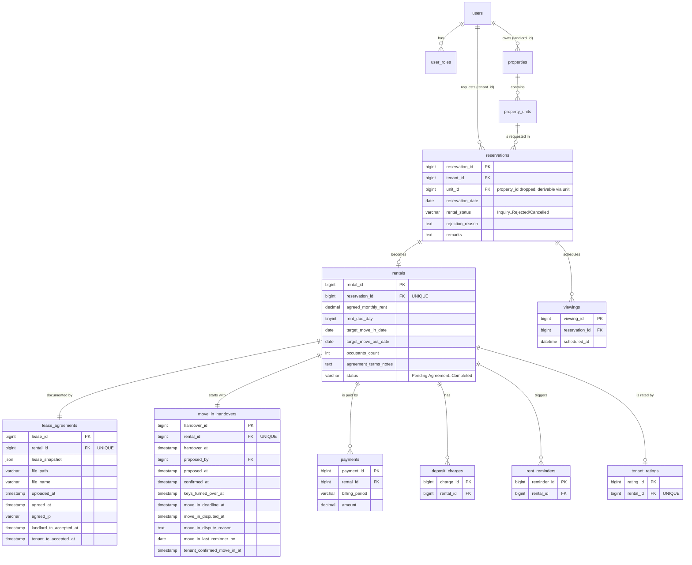

# Normalized ERD — reservation / rental split

**Status: proposed design, not the current database.** The live app keeps everything in one
`reservations` table (see `context/SCHEMA.md` §`reservations`). This diagram splits it by
lifecycle stage. Paste the block into https://mermaid.live to render it.

## What changed from the live schema

| Change | Why |
|---|---|
| New `rentals` | Rent, dates and occupants only exist once a booking is accepted. A rejected reservation never gets a row. |
| New `lease_agreements`, `move_in_handovers` | Each is a stage with its own set of columns that are NULL on most `reservations` rows today. |
| `payments`, `deposit_charges`, `rent_reminders`, `tenant_ratings` point to `rentals` | They describe the tenancy, not the request. |
| `viewings` stays on `reservations` | A viewing happens before any rental exists. |
| Dropped `reservations.property_id` | `unit_id` already determines the property (3NF). |
| Dropped `reservations.duration_of_stay` | Dead column; derivable from the two dates. |

## Not shown

Only the tables touched by the split are drawn in full. `conversations`, `messages`, `reviews`,
`favorites`, `reports`, `notifications`, media and amenity tables are unchanged from
`context/SCHEMA.md` §3.
